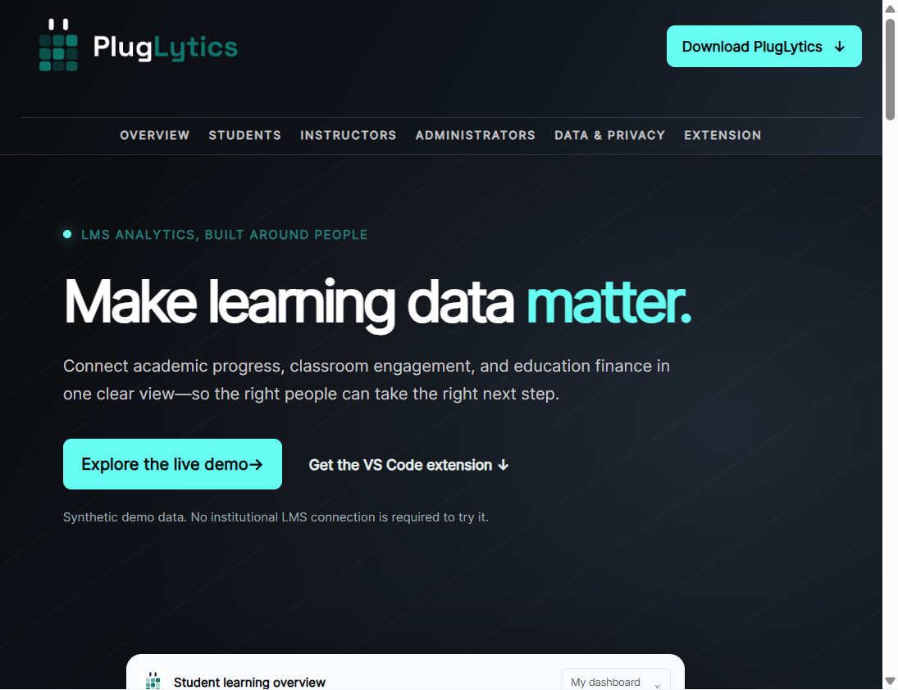

<h1 align="center">
  
</h1>

<p align="center">
  <strong>Learning progress, made clear.</strong><br />
  Privacy-conscious LMS analytics for students, instructors, and administrators, with Stellar Testnet tuition payments.
</p>

<p align="center">
  <strong><a href="https://pluglytics.xyz">Live demo</a></strong><br />
  Demo logins: <code>student@pluglytics.local</code>, <code>instructor@pluglytics.local</code>, or <code>admin@pluglytics.local</code> with password <code>Demo123!</code>
</p>

<p align="center">
  <a href="https://github.com/MitziReese04/PlugLytics/actions/workflows/ci.yml"></a>
  
  
  
</p>

<p align="center">
  <a href="#quick-start">Quick start</a> ·
  <a href="#features">Features</a> ·
  <a href="#stellar-testnet-payments">Stellar payments</a> ·
  <a href="#api-reference">API</a> ·
  <a href="#documentation">Docs</a> ·
  <a href="#roadmap">Roadmap</a>
</p>

<p align="center">
  
</p>

## Overview

PlugLytics is a zero-setup Learning Management System (LMS) analytics API and role-aware web dashboard. Students see their own progress, instructors see only the sections they teach, and administrators see enrollment, finance, and academic-quality reports. Invoices can be paid in XLM on the **Stellar Testnet**, confirmed through Horizon, and reconciled against the institution's records.

Built with Node.js, Express, SQLite, JWT, Zod, Chart.js, and Swagger/OpenAPI, plus a companion VS Code extension. The demo runs entirely on synthetic seeded data: 500+ students, 25 instructors, 60 courses, 6 specializations, and 4 academic terms.

> [!NOTE]
> PlugLytics is a technical demo and pilot candidate. Stellar payments run on the **Stellar Testnet**, so they can be tried end to end with free test XLM. There is no public deployment yet.

## Project status

| Area | Status |
| --- | --- |
| Analytics API, dashboard, and public website | Working locally |
| Stellar Testnet payments, refunds, webhooks, API keys, reconciliation and settlement reports | Working on Testnet, covered by automated tests |
| USDC, anchors, subscriptions | Planned |
| LMS provider import (Canvas) | Documented, not implemented ([plan](./docs/pilot/lms-integration.md)) |
| Continuous integration | GitHub Actions on every push and pull request to `main` |
| Public deployment | Deployed on Vercel as a Testnet demo with seeded data |

## Quick start

**Prerequisites:** Node.js 22.12 or newer (required by `better-sqlite3` 13 and `@stellar/stellar-sdk` 17) and npm. Windows, macOS, and Linux are supported.

```bash
cp .env.example .env      # Windows: copy .env.example .env
npm install
npm run seed              # builds the demo SQLite database
npm run dev               # starts the server on http://localhost:3000
```

| Surface | Localhost URL | Live URL |
| --- | --- | --- |
| Public website | <http://localhost:3000/public> | <https://pluglytics.xyz> |
| Analytics dashboard | <http://localhost:3000/public/dashboard.html> | <https://pluglytics.xyz/public/dashboard.html> |
| REST API | <http://localhost:3000/api/v1> | <https://pluglytics.xyz/api/v1> |
| Swagger UI | <http://localhost:3000/docs> | <https://pluglytics.xyz/docs> |
| Health check | <http://localhost:3000/api/v1/health> | <https://pluglytics.xyz/api/v1/health> |

Open the dashboard through the running server, not from the file system: sign-in and analytics need the server's `/api/v1` routes. No external database, cloud account, or other infrastructure is required.

## Live demo on Vercel

- Website: <https://pluglytics.xyz>
- Dashboard: <https://pluglytics.xyz/public/dashboard.html>
- API: <https://pluglytics.xyz/api/v1>
- Swagger docs: <https://pluglytics.xyz/docs>
- Health check: <https://pluglytics.xyz/api/v1/health>

The live demo runs on seeded synthetic data and Stellar Testnet only, with no real money.

Saved changes, including dashboard layouts and Testnet payment requests, can reset because the SQLite database is copied into `/tmp` on each Vercel instance.

### Demo accounts

| Role | Email | Password |
| --- | --- | --- |
| Student | `student@pluglytics.local` | `Demo123!` |
| Instructor | `instructor@pluglytics.local` | `Demo123!` |
| Admin | `admin@pluglytics.local` | `Demo123!` |

These accounts are created by `npm run seed` for local demonstration only.

## Why PlugLytics

Learning and financial information is often spread across LMS platforms, registrar spreadsheets, payment systems, and instructor reports. That makes it hard to answer simple questions consistently:

- Which students need support, without exposing unnecessary personal records?
- Which sections, assignments, or quiz items are causing trouble?
- How much tuition is billed, collected, outstanding, refunded, or discounted?
- Which courses, specializations, and terms are performing well?
- Can different roles rely on the same evidence without broadening access?

PlugLytics answers these from one role-aware analytics surface backed by a versioned REST API, with access rules enforced on the server.

## Features

### Students

- Course progress, quiz/assignment/exam averages, and GPA trend by term
- Upcoming and overdue deadlines, with a monthly calendar of assignment due dates
- Curriculum checklist grouped by year level, with completion percentage and remaining units
- Attendance, time on platform, and plain-language at-risk indicators
- Pay an open invoice in XLM on the Stellar Testnet

### Instructors

- Analytics limited to sections the signed-in instructor owns
- Class folders with per-student grades, attendance, submissions, lateness, and missed work
- Grade distribution, submission/late/missing rates, and hardest quiz questions
- Engagement by weekday and hour, section comparisons, and a follow-up list

### Administrators

- Enrollment by term, specialization, program, and year level; waitlists and seat utilization
- Retention and dropout rates; GPA, pass rates, instructor ratings, and course demand
- Gross and net billed, scholarships and discounts, collected, collection rate, outstanding balances by aging bucket, and refunds
- Invoice management with scholarship, discount, fee, and instructor-cost fields
- Stellar payment requests, late and memo-less payment matching, refunds, webhooks, customer API keys, and daily and weekly settlement reports

### Platform

- Role-aware widget catalog, custom layouts, named presets, and dark/light mode
- Universal filters, pagination, and CSV export
- Interactive Student, Instructor, and Admin previews on the public website
- Swagger/OpenAPI documentation and a VS Code extension

### Access by role

| Capability | Student | Instructor | Admin |
| --- | --- | --- | --- |
| Own progress, grades, curriculum, deadlines, attendance | Yes | - | - |
| Pay own invoices (Stellar Testnet) | Yes | - | - |
| Section rosters, grade distribution, assessment analytics | - | Own sections | - |
| At-risk indicators | Own records | Own sections | - |
| Enrollment, finance, academic, and operations analytics | - | - | Yes |
| Invoices, payments, refunds, webhooks, API keys, settlement reports | - | - | Yes |
| Custom dashboard | Yes | Yes | Yes |
| CSV export | Own tables | Own-section tables | Authorized reports |

## Stellar Testnet payments

PlugLytics converts an invoice into a Stellar payment request, waits for the student's payment, and confirms it on Horizon. All payment features run on the **Stellar Testnet** (`STELLAR_ENV=sandbox`, Horizon at `https://horizon-testnet.stellar.org`).

| Capability | Status |
| --- | --- |
| Payment requests: invoice converted to XLM at a configurable rate, locked for 30 minutes | Built (Testnet) |
| Horizon confirmation by memo, asset, and exact amount in stroops | Built (Testnet) |
| Cancelling requests, accepting late payments, matching payments sent without a memo | Built (Testnet) |
| Refunds with approval, rejection, second-admin threshold, and testnet refund payments | Built (Testnet) |
| Switch to turn refund sending off (`REFUND_ISSUING_ENABLED`): off by default and on the public demo | Built |
| Signed outgoing webhooks with per-customer secrets and automatic retries | Built (Testnet) |
| Read-only, school-scoped customer API keys | Built |
| Daily/weekly reconciliation and settlement reports (`npm run reconcile`, **Settlement reports** screen) | Built (Testnet) |
| USDC payments, anchors, subscriptions | Planned |

Still missing: USDC payment requests, subscriptions, admin pay-per-use requests, `GET /api/v1/payments/config` and `POST /api/v1/payments/:id/confirm`, watching Horizon by streaming or polling, wrong-asset refunds, dispute records, `REFUND_EXCEPTION_APPROVER`, subscription refunds, anchor payments, and production (Mainnet) support.

Settings marked **TODO: group decision** (exchange rates, amount limits, refund window, approval thresholds, approved anchors) are placeholders in [`.env.example`](./.env.example); copy them into your `.env`.

<details>
<summary><strong>Try a Testnet payment end to end</strong></summary>

Testnet XLM has **no real value**, so nothing here costs money.

1. **Copy the Stellar settings into `.env`.** Copy everything from `# --- Stellar merchant credentials ---` down from `.env.example` into your `.env`, and keep `STELLAR_ENV=sandbox`. Never put real keys in `.env.example` or any committed file.
2. **Create a testnet merchant account** (it receives the payments): open the [Stellar Laboratory](https://laboratory.stellar.org), switch to **Testnet**, and generate a keypair.
3. **Fund it with Friendbot**, which gives a new testnet account 10,000 test XLM:

   ```bash
   curl "https://friendbot.stellar.org?addr=YOUR_MERCHANT_PUBLIC_KEY"
   ```

4. **Add the `SANDBOX_` keys** in `.env`, replacing the placeholders:

   ```bash
   SANDBOX_MERCHANT_PUBLIC_KEY=<merchant G... key>
   SANDBOX_MERCHANT_SECRET_KEY=<merchant S... key>
   SANDBOX_WEBHOOK_SIGNING_SECRET=<any long random string>
   ```

5. **Restart the server** so it reads the new settings (run `npm run seed` first if you have not seeded since pulling).
6. **Sign in as the demo student.** In **Payments**, click **Pay with Stellar (Testnet)** on the unpaid 50 USD invoice. It asks for 125 XLM (sandbox rate: 1 USD = 2.5 XLM). Copy the **destination address**, **amount**, and **memo**.
7. **Pay from a second testnet account:** fund another keypair with Friendbot and send exactly that amount of XLM to the destination with the memo as a **text memo**, within 30 minutes. Without the memo, an admin has to match the payment manually.
8. The page checks every few seconds and shows **Completed** once the payment is found, or **Failed** with the reason. Sign in as the admin to see the request under **Stellar Payments**, linked to the transaction on [stellar.expert](https://stellar.expert/explorer/testnet).

The testnet is reset from time to time; after a reset, fund new accounts with Friendbot again.

</details>

## Architecture

```text
Public website  /  browser dashboard  /  VS Code extension
                          |
                          v
                     Express API  ------------->  Stellar Horizon (Testnet)
            JWT + RBAC + API-key middleware        payment lookup, refunds
                Zod query validation
             analytics and payment routes  ---->  Customer webhooks (signed)
                          |
                          v
                   SQLite database
              better-sqlite3 + SQL views
```

The static site and dashboard are served from `/public`, the API under `/api/v1`, and Swagger UI at `/docs`.

### Access-control model

Every API request passes through the same checks:

1. The JWT (or a customer API key, for read-only payment routes) identifies the caller.
2. RBAC middleware verifies the role.
3. Student and instructor endpoints apply row-level constraints derived from the signed-in account.
4. Every accepted query parameter is validated; disallowed filters return `403 FILTER_FORBIDDEN`.
5. Small cohorts are withheld or reduced to anonymous bands.
6. Dashboard views and CSV exports use the same filtered response envelope.

### Tech stack

| Layer | Technology |
| --- | --- |
| Runtime and API | Node.js 22, Express 5 |
| Database | SQLite through `better-sqlite3` |
| Authentication | JWT, bcrypt password hashing |
| Validation | Zod |
| Payments | Stellar Horizon REST API, `@stellar/stellar-sdk` (refund signing) |
| Security | Helmet, express-rate-limit |
| API docs | Swagger UI / OpenAPI |
| Dashboard | Vanilla JavaScript and Chart.js |
| Tests and CI | Jest, Supertest, GitHub Actions |
| Editor integration | VS Code Extension API |

### Repository layout

```text
PlugLytics/
├── .github/workflows/   CI workflow
├── docs/
│   ├── pilot/           Deployment, Canvas LMS, pilot school, definitions, accounting
│   └── stellar/         Payments API, webhooks, settlement, refunds, budget
├── logo/                Brand assets
├── pluglytics-vscode/   VS Code extension source, tests, and VSIX
├── public/              Public website and role-aware dashboard
├── scripts/             Seed, migrate, backup, and reconcile scripts
├── src/
│   ├── middleware/      JWT, RBAC, API keys, and query validation
│   ├── routes/          Analytics, invoice, payment, refund, settlement, webhook, and API-key routes
│   ├── utils/           Response envelope, CSV export, finance cache
│   ├── stellar*.js      Stellar config, Horizon lookup, quotes, refund signer, reconciliation
│   ├── webhook*.js      Webhook signing secrets and delivery
│   ├── schema.sql       Tables, indexes, views, and triggers
│   └── openapi.js       Swagger document
├── tests/               Jest test suites
├── api.http             REST Client request examples
├── PROPOSAL.md          Grant proposal
└── render.yaml          Render deployment Blueprint (demo)
```

## Configuration

Create `.env` from `.env.example`. Stellar settings are described in [Stellar Testnet payments](#stellar-testnet-payments) and [payments-api.md](./docs/stellar/payments-api.md#payment-policy-settings).

| Variable | Purpose | Default | Required |
| --- | --- | --- | --- |
| `PORT` | API listen port | `3000` | No |
| `JWT_SECRET` | Signs JWTs | Development fallback | In production |
| `JWT_EXPIRES_IN` | JWT lifetime | `8h` | No |
| `DATABASE_PATH` | SQLite database location | `./data/pluglytics.db` | No |
| `TRUST_PROXY` | Reverse proxies in front of the app, so rate limiting sees each visitor's IP | `0` | On Render: `1` |
| `BACKUP_DIR` | Where `npm run backup` writes copies | `backups/` next to the database | No |
| `BACKUP_KEEP` | Backup copies to keep | `7` | No |
| `STELLAR_ENV` | `sandbox` selects the Stellar Testnet | - | For payments |
| `REFUND_ISSUING_ENABLED` | Whether this server may send testnet refund payments | `false` | Set `true` locally to send testnet refunds; keep `false` on the public demo |

| Command | What it does |
| --- | --- |
| `npm run dev` | Starts the server and restarts it on file changes |
| `npm start` | Starts the server |
| `npm run seed` | Rebuilds the demo database. **Replaces all data**; never run it on real data |
| `npm run migrate` | Creates missing tables, indexes, views, and triggers; never deletes data |
| `npm run backup` | Writes a checked copy of the database and keeps the newest `BACKUP_KEEP` copies |
| `npm run reconcile` | Reconciles the Stellar Testnet merchant account and saves settlement reports (`-- daily YYYY-MM-DD` or `-- weekly [YYYY-MM-DD]`; default: yesterday). Read-only on Horizon; see [settlement.md](./docs/stellar/settlement.md#what-is-built) |
| `npm test` | Runs the Jest test suites |
| `npm run package:plugin` | Packages the VS Code extension as a VSIX |

## API reference

Full interactive documentation is served at `/docs`. Every response uses the same envelope:

```json
{
  "data": {},
  "meta": { "filtersApplied": {}, "generatedAt": "", "page": 1, "total": 0 },
  "error": null
}
```

<details>
<summary><strong>Authentication and dashboard</strong></summary>

| Method | Endpoint | Description |
| --- | --- | --- |
| POST | `/api/v1/auth/login` | Sign in and receive a JWT |
| GET | `/api/v1/auth/me` | Return the signed-in user |
| GET | `/api/v1/widgets` | Role-available widget catalog |
| GET / PUT | `/api/v1/me/dashboard` | Read or save the dashboard layout |
| POST | `/api/v1/me/dashboard/presets` | Save a named preset |
| GET | `/api/v1/me/dashboard/render` | Render selected widgets |
| GET | `/api/v1/me/filter-options` | Role-permitted term and activity dates |

</details>

<details>
<summary><strong>Student</strong></summary>

| Method | Endpoint | Description |
| --- | --- | --- |
| GET | `/api/v1/student/progress` | Own course progress |
| GET | `/api/v1/student/calendar?from=&to=` | Own assignment deadlines for a date range |
| GET | `/api/v1/student/curriculum` | Program checklist and unit completion |
| GET | `/api/v1/student/grades` | Own grade and GPA trend |
| GET | `/api/v1/student/deadlines` | Upcoming and overdue items |
| GET | `/api/v1/student/attendance` | Own attendance summary |
| GET | `/api/v1/student/activity-summary` | Own learning activity by course |
| GET | `/api/v1/student/risk` | Plain-language at-risk indicator |

</details>

<details>
<summary><strong>Instructor</strong></summary>

| Method | Endpoint | Description |
| --- | --- | --- |
| GET | `/api/v1/instructor/sections` | Own sections |
| GET | `/api/v1/instructor/sections/:sectionId/roster` | Section grades, attendance, and assessment completion |
| GET | `/api/v1/instructor/attendance` | Attendance rates for owned sections |
| GET | `/api/v1/instructor/distribution` | Grade distribution |
| GET | `/api/v1/instructor/assignments` | Assignment analytics |
| GET | `/api/v1/instructor/item-analysis` | Quiz item difficulty |
| GET | `/api/v1/instructor/engagement` | Weekday/hour activity |
| GET | `/api/v1/instructor/at-risk` | At-risk indicators for owned sections |
| GET | `/api/v1/instructor/compare` | Section and term comparisons |

</details>

<details>
<summary><strong>Admin analytics</strong></summary>

| Method | Endpoint group | Description |
| --- | --- | --- |
| GET | `/api/v1/admin/enrollment/*` | Enrollment, retention, and seat analytics |
| GET | `/api/v1/admin/finance/*` | Billing, collection, outstanding, and refund analytics |
| GET | `/api/v1/admin/academics/*` | GPA, pass rates, and ratings |
| GET | `/api/v1/admin/operations/*` | Course popularity |

</details>

<details>
<summary><strong>Invoices and Stellar payments</strong></summary>

| Method | Endpoint | Who | Description |
| --- | --- | --- | --- |
| GET / POST | `/api/v1/invoices` | Admin | List or create invoices with pricing fields |
| GET / PATCH | `/api/v1/invoices/:id` | Admin | Read or update an invoice |
| POST | `/api/v1/payments` | Student | Create a Testnet payment request for an own invoice |
| GET | `/api/v1/payments` | Admin, API key | List payment requests |
| GET | `/api/v1/payments/invoices` | Student | Own invoices with amount due and latest request |
| GET | `/api/v1/payments/:id` | Student, admin, API key | Read a request, checking Horizon while it is pending |
| POST | `/api/v1/payments/:id/cancel` | Student, admin | Cancel a pending request |
| POST | `/api/v1/payments/:id/accept-late-payment` | Admin | Record a payment that arrived after expiry |
| POST | `/api/v1/payments/:id/match-transaction` | Admin | Record a payment sent without a memo |
| GET / POST | `/api/v1/refunds` | Admin | List or request refunds |
| POST | `/api/v1/refunds/:id/approve`, `/reject`, `/issue` | Admin | Decide on or send a refund (Testnet only) |
| GET / POST | `/api/v1/webhooks` | Admin | List or register webhook endpoints |
| DELETE | `/api/v1/webhooks/:id` | Admin | Remove a webhook endpoint |
| POST | `/api/v1/webhooks/:id/rotate-secret` | Admin | Replace a signing secret |
| GET / POST | `/api/v1/api-keys` | Admin | List or create customer API keys |
| DELETE | `/api/v1/api-keys/:id` | Admin | Revoke a customer API key |
| GET | `/api/v1/settlements`, `/api/v1/settlements/:id`, `/api/v1/settlements/:id/items.csv` | Admin | Settlement reports, their items, and the CSV export |
| POST | `/api/v1/settlements/run` | Admin | Run a daily or weekly reconciliation now (Testnet only) |

See [payments-api.md](./docs/stellar/payments-api.md) for request and response fields and error codes.

</details>

<details>
<summary><strong>Examples</strong></summary>

```bash
# Sign in
curl -X POST http://localhost:3000/api/v1/auth/login \
  -H "Content-Type: application/json" \
  -d '{"email":"student@pluglytics.local","password":"Demo123!"}'

# Authenticated request
curl http://localhost:3000/api/v1/student/progress \
  -H "Authorization: Bearer YOUR_JWT"

# CSV export
curl "http://localhost:3000/api/v1/admin/enrollment/by-specialization?term=2025-1&format=csv" \
  -H "Authorization: Bearer YOUR_JWT"
```

</details>

### Filters

Analytics endpoints accept the role-permitted subset of `term`, `from`, `to`, `specialization`, `program`, `course`, `section`, `instructor`, `yearLevel`, `status`, `groupBy`, `granularity`, `compare`, `sort`, `page`, and `limit`. A disallowed filter returns HTTP `403` with `FILTER_FORBIDDEN`.

### Metric formulas

| Metric | Formula |
| --- | --- |
| Course progress | Submitted or late items / total assigned items × 100 |
| Submission rate | Submitted or late submissions / enrolled students × 100 |
| Average score | Sum of (score / maximum score × 100) / score count |
| Gross billed | Sum of invoice base amounts |
| Net billed | Gross billed − scholarships − discounts + fees |
| Collection rate | Collected payments / net billed × 100 |
| Outstanding balance | Net billed per invoice − payments |
| Aging bucket | Days since due date: 0–30, 31–60, or 60+ |
| Retention rate | Active enrollments / total enrollments × 100 |
| Dropout rate | Dropped or withdrawn enrollments / total enrollments × 100 |
| Pass rate | Final grade ≥ 60 / graded enrollments × 100 |
| Seat utilization | Enrolled students / section capacity × 100 |
| At-risk | 2+ missing submissions and/or attendance below 75%, with plain-language reasons |

Known gaps in these definitions (for example, retention for finished terms, and Stellar payments and refunds not yet counted in "collected") are tracked in [definitions.md](./docs/pilot/definitions.md) for review with the pilot school.

## Privacy and security

- JWT authentication with role claims and role-based route authorization
- Student identity derived from the signed-in account; instructor queries limited to owned sections
- Minimum cohort size of five for privacy-sensitive aggregates
- bcrypt password hashing, Helmet security headers, and per-IP rate limiting
- Failed sign-ins limited to 10 per IP per 15 minutes; the server refuses to start in production without a unique `JWT_SECRET`
- Webhook URLs must use HTTPS and cannot point to private or internal IP addresses
- Zod validation of inputs and query parameters
- Customer API keys stored as SHA-256 hashes; webhook secrets stored encrypted and shown once
- Stellar secret keys read only from the environment and never logged
- Standardized error envelopes with no stack traces returned to clients

Production use still requires a privacy review, threat model, audit logging, secret management, HTTPS, backups, and a production database strategy.

## VS Code extension

The extension source is in [pluglytics-vscode](./pluglytics-vscode); a packaged VSIX is also served from the public website's **Download PlugLytics** button.

```bash
npm run package:plugin
code --install-extension pluglytics-vscode/pluglytics-0.1.0.vsix
```

Commands: **Open Dashboard**, **Open API Documentation**, **Start API**, **Check API Health**, **Connect Account**, **Refresh Available LMS Dates**, **Filter Dashboard by Date**, **Configure LMS Date API**, and **Set LMS API Token** (all prefixed with `PlugLytics:`).

The API URL is set with `pluglytics.baseUrl`. After connecting, the extension refreshes role-scoped date choices and can open the dashboard filtered to a term or date range. An optional `pluglytics.lmsDateOptionsUrl` points to a JSON endpoint on the institution's LMS from which the extension reads ISO dates or Unix timestamps.

**Open Dashboard** checks the API first and automatically starts `npm run dev` as a VS Code task when the default local server is stopped. It waits for the health check before opening the page; keep that task running while you use the dashboard. If `pluglytics.baseUrl` points to a custom or remote server, start that server separately.

> [!NOTE]
> The LMS connector reads dates only. It does not scrape LMS pages, implement provider-specific OAuth or pagination, or import enrollments, grades, courses, curriculum, attendance, or events. The sample curriculum and demo events on the website are static files under `public/` and never enter the API or database.

## Testing and CI

```bash
npm run seed
npm test                          # API test suites (Jest + Supertest)
cd pluglytics-vscode && npm test  # VS Code extension tests
```

The suites in [`tests/`](./tests) cover authentication and role boundaries, filters, dashboard layouts, finance and pricing calculations, invoices, payment requests, Horizon confirmation, late and memo-less matching, refunds and the refund issuing switch, reconciliation and settlement reports, webhook registration and delivery, customer API keys, payment-policy settings, and dashboard assets. Horizon and the refund signer are replaced with test doubles, so the tests never call the real Stellar network.

[GitHub Actions](./.github/workflows/ci.yml) runs install, seed, the API tests, and the extension tests on Node.js 22 for every push and pull request to `main`. CI does not deploy.

## Documentation

| Document | Contents |
| --- | --- |
| [PROPOSAL.md](./PROPOSAL.md) | Grant proposal, roadmap, impact, and evaluation metrics |
| [Payments API](./docs/stellar/payments-api.md) | Payment flow, endpoints, API keys, error codes, sandbox vs production |
| [Webhooks](./docs/stellar/webhooks.md) | Event types, payloads, signature verification, retries |
| [Settlement](./docs/stellar/settlement.md) | Accepted assets, reconciliation, settlement reports, mismatches |
| [Approved payment methods](./docs/stellar/approved-payment-methods.md) | XLM, USDC, anchors, limits, and what is not accepted |
| [Refunds and chargebacks](./docs/stellar/refunds-and-chargebacks.md) | Refund procedure, partial refunds, disputes, record-keeping |
| [Pilot budget and grant](./docs/stellar/pilot-budget-and-grant.md) | Budget categories, milestones, and reporting dates |
| [Deployment](./docs/pilot/deployment.md) | Hosting, URLs, database, and backups |
| [LMS integration](./docs/pilot/lms-integration.md) | Canvas LMS import and LTI plan |
| [Definitions](./docs/pilot/definitions.md) | Enrollment, retention, and finance definitions |
| [Accounting and ledger](./docs/pilot/accounting-and-ledger.md) | Journal export and accounting mapping |
| [Pilot institution](./docs/pilot/pilot-institution.md) | Pilot school template |

## Roadmap

- [x] Role-aware analytics API, dashboard, and public website
- [x] Stellar Testnet payment adapter: payment requests, Horizon confirmation, late and memo-less matching, refunds, webhooks, customer API keys
- [x] Daily and weekly reconciliation and settlement reports (Testnet)
- [x] Automated CI with GitHub Actions
- [x] Live public deployment on Vercel with HTTPS
- [ ] USDC payments and anchors on Testnet, then a production rollout after the pilot review
- [ ] Provider-specific LMS integration (Canvas) for enrollments, courses, grades, attendance, and events
- [ ] Revenue forecast and course-margin reporting
- [ ] Code-quality (lint) workflow
- [ ] VS Code Marketplace publication
- [ ] Pilot institution approval and data-governance review
- [ ] Production backups, versioned migrations, logging, and monitoring
- [ ] Pilot user testing, accessibility audit, and formal privacy and security review

<details>
<summary><strong>Open items before the pilot</strong></summary>

| # | Item | Status | Still missing |
| --- | --- | --- | --- |
| 1 | Hosting provider and domain ([deployment](./docs/pilot/deployment.md#1-hosting-provider-and-domain)) | Documented, partly built | Vercel demo deployed; custom domain, account owner, and production hosting decisions remain |
| 2 | Public API and Swagger URLs ([deployment](./docs/pilot/deployment.md#2-public-api-and-swagger-urls)) | Live on Vercel demo | Production/public API URL strategy remains |
| 3 | Production database and backups ([deployment](./docs/pilot/deployment.md#3-production-database-strategy)) | Partly built (`migrate`, `backup`) | Scheduled and off-site backups, versioned migrations, PostgreSQL plan |
| 4 | Pilot LMS provider ([LMS integration](./docs/pilot/lms-integration.md)) | Canvas chosen, not built | School's Canvas URL, quiz engine, attendance source; importer |
| 5 | Pilot institution and contact ([template](./docs/pilot/pilot-institution.md)) | Template only | No school has agreed yet |
| 6 | Enrollment, retention, and finance definitions ([definitions](./docs/pilot/definitions.md)) | Documented | Confirmation by the school's registrar and finance office |
| 7 | Ledger and accounting system ([accounting](./docs/pilot/accounting-and-ledger.md)) | Documented, not decided | School's accounting system, account codes, journal export |
| 8 | Stellar merchant credentials ([payments API](./docs/stellar/payments-api.md#sandbox-vs-production)) | Testnet supported | Testnet merchant keys per deployment |
| 9 | Settlement and webhooks ([settlement](./docs/stellar/settlement.md), [webhooks](./docs/stellar/webhooks.md)) | Payments, webhooks, refunds, reconciliation and settlement reports built on Testnet | `subscription.*` events, withdrawals as records, production (Mainnet) |
| 10 | Payment methods and refunds ([methods](./docs/stellar/approved-payment-methods.md), [refunds](./docs/stellar/refunds-and-chargebacks.md)) | Refunds built on Testnet, with the `REFUND_ISSUING_ENABLED` switch | Wrong-asset refunds, disputes, `REFUND_EXCEPTION_APPROVER`, subscription refunds; real limits, refund window, approval thresholds and anchor list (placeholders in [`.env.example`](./.env.example)) |
| 11 | Pricing fields ([payments API](./docs/stellar/payments-api.md#pricing-fields)) | Built (API and admin screen) | Course-margin reporting using instructor cost |
| 12 | Pilot budget and grant ([budget](./docs/stellar/pilot-budget-and-grant.md)) | Draft | Grant amount, budget amounts, milestone and report dates |
| 13 | User testing | Not started | Population and target sample size |
| 14 | Compliance | Not started | Security, accessibility, and compliance requirements |
| 15 | Brand and media | Pending | Logo approval for public and grant use; video assets |
| 16 | Publication | Pending | License, maintainers, support/privacy/terms/disclosure URLs, release strategy, Marketplace publisher ID |

</details>

## License

A license has not been selected yet. Until one is added, all rights are reserved by the authors.
